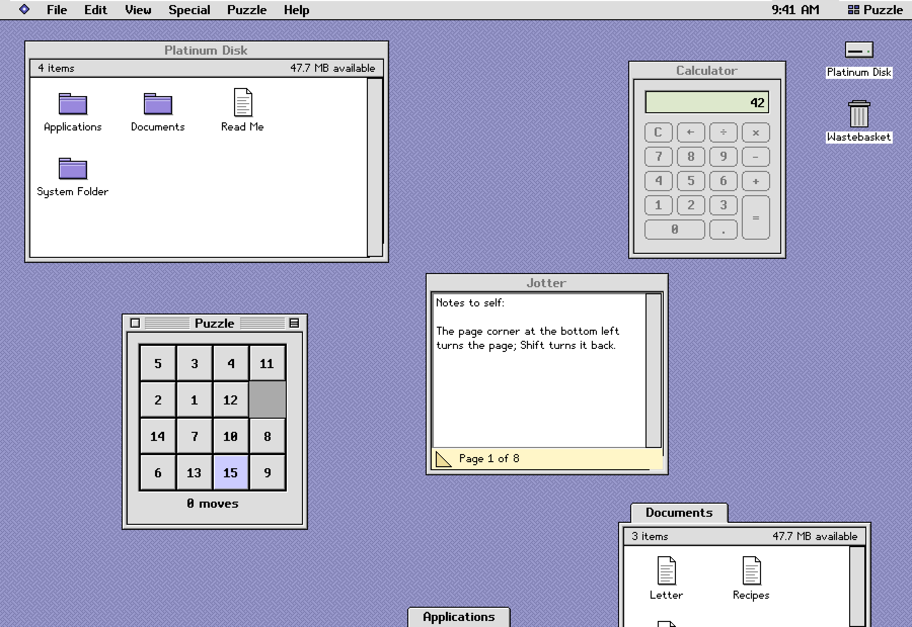

# gpui-platinum

English | [简体中文](README.zh.md)

[](https://github.com/firede/gpui-platinum/actions/workflows/verify.yml)

A set of controls for [GPUI](https://github.com/longbridge/gpui-fast) in the
style of the gray, beveled late-1990s "Platinum" desktop look — drawn pixel
by pixel through GPUI's renderer — and a "classic desktop" example that puts
them to work. It is the Rust port of
[mygo-platinum](https://github.com/firede/mygo-platinum). See the desktop,
as GPUI draws it, at
[gpui-platinum.firede.com](https://gpui-platinum.firede.com).


More: [page 2](docs/gallery-2@2x.png) (bevel buttons, toolbar, fields,
status, rich text, pop-up windows), [page 3](docs/gallery-3@2x.png) (lists,
tables, layout), [page 4](docs/gallery-4@2x.png) (dates, colors, sheet,
ruler), [page 5](docs/gallery-5@2x.png) (documents and navigation).

> **A tribute in style only.** This project is not affiliated with, endorsed
> by or connected to Apple Inc. It uses none of Apple's fonts, icons, images
> or trademarks: its Latin bitmap faces, its icons and every picture in it
> were drawn for mygo-platinum, its East Asian glyphs come from the open
> Fusion Pixel Font, and its design specification
> ([docs/spec.md](docs/spec.md)) is written from scratch.

> [!WARNING]
> **An early, personal project.** It was made for its author's own use and
> is shared as it is, with no promise of support. Its API may change in any
> 0.x release, and it is built on gpui-fast v0.1.12 (revision `07b42eb`),
> itself young and changing. Pin a version, and expect to adapt.

## What is in it

| Control | Function |
|---|---|
| Push button, default and cancel buttons | `button` |
| Check box (with a mixed state) | `checkbox` |
| Radio button and radio group | `radio`, `ChoiceGroup::radio` |
| Slider (with tick marks) | `Slider` |
| Progress bar, determinate and indeterminate | `progress_bar`, `indeterminate_progress` |
| Disclosure triangle | `disclosure` |
| Group box and separator | `group_box`, `separator` |
| Tab control | `tab`, `ChoiceGroup::tabs` |
| Pop-up menu | `PopupMenu` |
| Text field, password field, text area | `TextField` |
| List box (with icons, dimmed rows) | `ListBox` |
| Scroll bar | `ScrollBar` |
| Window frame: striped title bar, close, zoom and collapse boxes, resize corner, path menu | `PlatinumWindow` |
| Menu bar, menus, submenus, keyboard equivalents | `MenuBar`, `Menu`, `MenuItem` |
| Alert box, movable modal dialog | `Alert`, `Dialog` |
| Text in the bitmap faces | `label`, `text_in`, `paragraph` |
| Bevel button, icon button, toggle, segmented control | `bevel_button`, `icon_button`, `ChoiceGroup::segments` |
| Toolbar with an overflow menu | `Toolbar` |
| Little arrows, number field, search field | `Stepper`, `NumberField`, `SearchField` |
| Chasing arrows, placard, window header, badge, tag, image well | `chasing_arrows`, `placard`, `window_header`, `badge`, `tag`, `image_well` |
| Help balloon, context menu | `Balloon`, `ContextMenu` |
| Tree view, sortable table, icon view | `TreeView`, `Table`, `IconView` |
| Split, scroll view, utility window | `Split`, `ScrollView`, `PlatinumWindow` with `utility` |
| Calendar, date picker, time field | `CalendarView`, `DatePicker`, `TimeField` |
| Combo box, color well and color picker | `Combobox`, `ColorWell` |
| Spreadsheet sheet with formulas, formula bar | `SheetView` |
| Find and replace dialog, ruler | `FindReplace`, `find_next`, `replace_all`, `Ruler` |
| Column view, document tabs, font picker, page setup | `ColumnView`, `DocumentTabs`, `FontPicker`, `PageSetup` |
| Progress dialog, banner, toasts, empty state | `ProgressDialog`, `Banner`, `Toasts`, `empty_state` |
| Path pop-up, breadcrumb, pagination, card, status bar | `PathPopup`, `Breadcrumbs`, `Pagination`, `card`, `status_bar` |
| Rich text: styles, four sizes, paragraph alignment; format bar | `RichTextArea`, `SizeMenu` |
| Pop-up window docked at the bottom edge | `PopupWindow` |
| Open and save dialogs | `OpenDialog`, `SaveDialog` |
| Zoom rectangles of a window opening | `zoom_rects` |

Every control has its states (pressed, disabled, focused, default, checked,
selected, and inactive in a window in the background), is operated from the
keyboard, and describes itself to screen readers through GPUI's
accessibility support. Those with a look of their own are drawn with an
exported `draw_…` function too, for controls of your own that look like
them.

The names follow mygo-platinum's, in Rust's conventions. Where the two
differ:

| mygo-platinum | This library |
|---|---|
| `Button`, `Checkbox`, `Disclosure` | `button`, `checkbox`, `disclosure` |
| `RadioGroup`, `TabControl`, `Segmented` | `ChoiceGroup::radio`, `::tabs`, `::segments` |
| `TextArea` | `TextField` with `.multiline(true)` |
| `SplitPercent`, `SplitVertical` | `Split` with `.percent()`, `.vertical()` |
| `Calendar`, `Sheet` | `CalendarView`, `SheetView` |
| `FormulaBar`, `FormatBar` | part of `SheetView` and `RichTextArea` |
| `Window` | `PlatinumWindow` |
| `Find`, `ReplaceAll` | `find_next`, `replace_all` |
| `SpringOpen`, `ZoomRects` | `PopupWindow::spring_open`, `zoom_rects` |
| `Card`, `EmptyState` | `card`, `empty_state` |

## Using it

It needs a current stable Rust (gpui-fast builds with 1.98) and gpui-fast
v0.1.12, revision `07b42eb`. An application's own GPUI dependencies must
be on the same revision: types from another GPUI are not interchangeable.

```toml
[dependencies]
gpui-platinum = { git = "https://github.com/firede/gpui-platinum", tag = "v0.1.1" }
gpui = { git = "https://github.com/longbridge/gpui-fast", rev = "07b42eb" }
gpui_platform = { git = "https://github.com/longbridge/gpui-fast", rev = "07b42eb", features = ["font-kit", "runtime_shaders", "wayland", "x11"] }
```

```rust
use gpui::{prelude::*, *};
use gpui_platinum::{CheckState, MenuEvent, PopupMenu, Slider, button, button_scope, checkbox};

struct Settings {
    sound: bool,
    volume: f64,
    sort: Entity<PopupMenu>,
    sort_by: usize,
    _sort_changed: Subscription,
}

impl Settings {
    fn new(cx: &mut Context<Self>) -> Self {
        let sort = cx.new(|cx| PopupMenu::new(["Name", "Date", "Size"], cx).caption("Sort by:"));
        let _sort_changed = cx.subscribe(&sort, |this, _, MenuEvent(index), cx| {
            this.sort_by = *index;
            cx.notify();
        });
        Self { sound: true, volume: 50., sort, sort_by: 0, _sort_changed }
    }

    fn apply(&mut self) { /* … */ }
}

impl Render for Settings {
    fn render(&mut self, _: &mut Window, cx: &mut Context<Self>) -> impl IntoElement {
        let set_volume = cx.listener(|this, volume: &f64, _, cx| {
            this.volume = *volume;
            cx.notify();
        });
        let sound = if self.sound { CheckState::On } else { CheckState::Off };
        button_scope(
            "settings",
            div()
                .flex()
                .flex_col()
                .p(px(12.))
                .gap(px(8.))
                .child(checkbox("sound", "Play alert sounds", sound).on_click(cx.listener(
                    |this, _, _, cx| {
                        this.sound = !this.sound;
                        cx.notify();
                    },
                )))
                .child(
                    Slider::new("volume", self.volume, 0., 100.)
                        .label("Volume")
                        .on_change(move |volume, window, cx| set_volume(&volume, window, cx)),
                )
                .child(self.sort.clone())
                .child(
                    div()
                        .flex()
                        .gap(px(10.))
                        .child(button("cancel", "Cancel").cancel_button())
                        .child(button("ok", "OK").default_button().on_click(cx.listener(
                            |this, _, _, _| this.apply(),
                        ))),
                ),
        )
    }
}

fn main() {
    gpui_platform::application().run(|cx: &mut App| {
        gpui_platinum::init(cx); // once, before the first window
        cx.open_window(WindowOptions::default(), |_, cx| cx.new(Settings::new))
            .expect("open a window");
        cx.activate(true);
    });
}
```

Controls come in two kinds. Light ones — `button`, `checkbox`, `Slider`,
`ChoiceGroup` and the displays — are elements built anew on every render
from the application's state: give each a stable ID, and update the state
and call `cx.notify()` in its callback. Controls that keep state of their
own — `TextField`, `PopupMenu`, `ListBox`, `Table`, the dialogs — are
entities: make them once with `cx.new`, keep the handle, and subscribe to
their typed events. `button_scope` lets Return and Escape reach the default
and cancel buttons inside it. The [API guide](docs/api.md) covers both kinds,
focus, languages and drawing; `cargo doc --no-deps --open` opens the
reference.

Six accents ship with it — Lavender, Graphite, Harbor, Moss, Ember and
Orchid — in `theme::ACCENTS`, set with `Theme::accent`.

## The classic desktop



`examples/desktop.rs` is a whole desktop in one window: a menu bar with a
clock and an application menu, icons that open and that drop on the
Wastebasket, windows that move, resize, roll up, zoom and dock at the
bottom as pop-up windows, a browser of its own little disk (as icons,
buttons, a list or columns, with spring-loaded folders, Option-drag
copies, Get Info, Duplicate, Put Away and a path menu in each window's
title) with Find File, and applications built from the controls —
Calculator, Jotter (a note pad), Scribe (a rich text editor with styles,
sizes, a ruler, find and replace, page setup, and the open and save
dialogs), Ledger (a spreadsheet), Puzzle, Alarm Clock, Controls (every
control of the library, live, by the name of its function), and the
Appearance, Date & Time, Language, Sound and Mouse control panels. All of
its names and pictures are its own. The disk lives in memory; the open and
save dialogs browse it, not the computer's files.

It speaks English, Simplified and Traditional Chinese, Japanese and
Korean, the language of the system or the one its Language control panel
chooses: its words, dates and times, and the forms of East Asian
characters. Its catalogs are in `assets/locales/desktop`.

The site shows pictures of the desktop that GPUI draws; the desktop itself
runs natively, not in the browser.

## Running the examples

```sh
cargo run --example gallery                    # every control, on five pages
cargo run --example gallery -- --png gallery.png --page 2   # a page, rendered without a window
cargo run --example controls                   # every control, by the name of its function
cargo run --example desktop                    # the classic desktop
cargo run --example desktop -- --png desk.png --lang ja     # a picture of it, in Japanese
```

`--scale 2` renders a picture at twice the size. Pictures are rendered with
GPUI's offscreen renderer, which the pinned revision has on macOS and
Linux, not on Windows. `./scripts/screenshots.sh` renders the pictures in
`docs`, and `./scripts/bundle.sh --gallery` (or `--desktop`) builds a macOS
app bundle of an example.

`./scripts/site.sh` builds the web page, with the pictures the desktop
draws (`desktop --site <dir>`), into `site/dist`; `./scripts/deploy.sh`
builds it for its address and deploys it to Cloudflare, as `wrangler.jsonc`
says, which publishing a release on GitHub does too. After the page's words
change, `./scripts/site-fonts.sh` subsets its fonts to them again.

## Testing

```sh
./scripts/verify.sh
```

runs `cargo fmt --check`, every test of every target, the doc tests and
Clippy with warnings denied; GitHub runs it on macOS, Windows and Linux.
Arguments go on to Cargo, as `--offline`. The tests include:

- scenes of every control, the gallery's pages and the desktop, drawn by
  GPUI's offscreen renderer and compared pixel for pixel with
  mygo-platinum's golden images in `tests/reference/snapshots`. They run
  on macOS, where Metal draws them, and are skipped elsewhere:

  ```sh
  cargo test --test snapshots             # every scene
  cargo test --test snapshots -- tabs     # the scenes named with "tabs"
  ```

  A scene that differs leaves what it drew, and a map of the pixels that
  differ in red, in `target/snapshots`; a scene marked pending reports
  its differences without failing;
- controls' drawings compared with mygo-platinum's pictures in
  `tests/reference`;
- what the controls do from the keyboard, with menus and ranges, and over
  time (flashes, blinks, repeats, delays), by the test executor's clock;
- `Font::measure_styled` against what `Pen::text_styled` draws;
- unit tests of the text buffer, rich text, dates, formulas, trees and the
  desktop's applications.

After a deliberate change to how a control looks, run
`./scripts/screenshots.sh` and look at the new pictures in `docs`.

## Notes

- Pixels are GPUI's logical pixels: the controls are crisp at any whole
  scale of the display, and drawn in blocks of 2×2 pixels on a 2× display.
- Text is drawn with the bitmap faces of
  [platinum-fonts](https://github.com/firede/platinum-fonts), bundled in
  `assets/fonts`: Platinum Sans Bold (`Font::Bold`) and Platinum Sans
  Small (`Font::Small`), with `Font::Sans` and `Font::SmallBold`. They cover
  ASCII, common punctuation, every letter of Latin-1 (accented letters, Æ,
  Ð, Ø, Þ, Œ, ß) and the Central European letters most used (Ł, Ś, Č, Ő,
  Ą…).
- East Asian text is drawn with the 12px faces of platinum-fonts' `cjk12`,
  bundled in four regional forms; a control's `.language(…)` chooses the
  forms. Characters no face draws — Greek, other accented letters — draw
  in the system's font on the same baseline once `init` has run, so any
  text can be typed.
- The controls' own words — buttons, dialogs, labels and the names screen
  readers read — come in English, Simplified and Traditional Chinese,
  Japanese and Korean, from `assets/locales/controls`, in the `Language`
  each control is given. Calendars, date pickers and time fields write
  dates as the language does; `first_weekday`, `day_first` and
  `hour_cycle` follow the user's regional formats.
- Lines of text make room for East Asian glyphs, as mygo-platinum's do once
  it has East Asian faces. `text_input::set_east_asian_line_room(false)`
  fits English lines to the Latin face alone.

## License

MIT — see [LICENSE](LICENSE). The faces come from
[platinum-fonts](https://github.com/firede/platinum-fonts), whose glyph
data is under the SIL Open Font License 1.1; see
[assets/fonts](assets/fonts).
