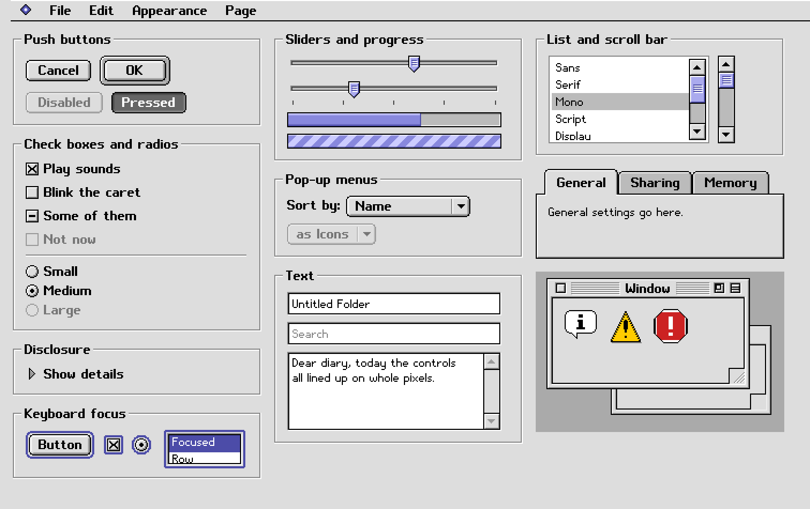
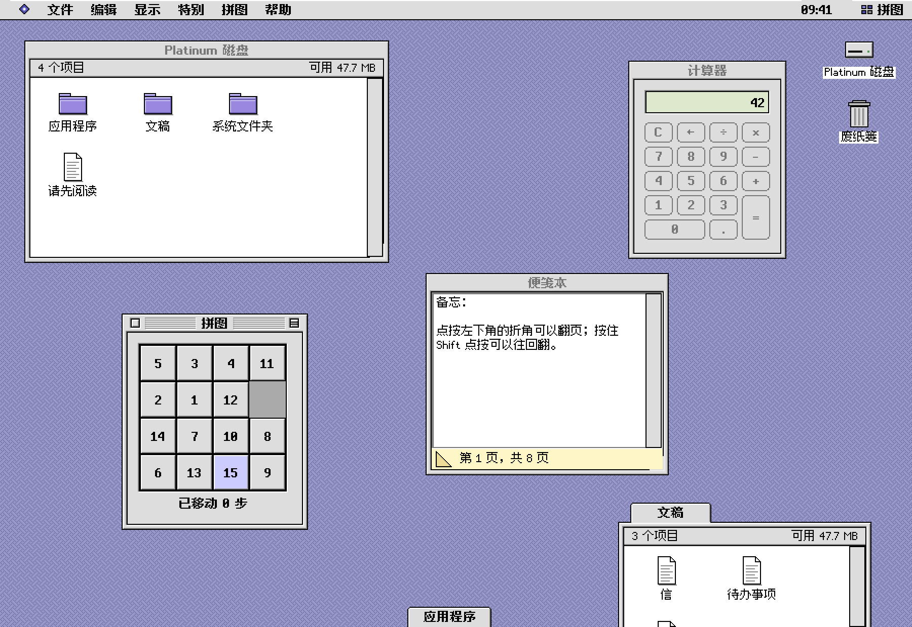

# gpui-platinum

[English](README.md) | 简体中文

一套面向 Rust 与 [GPUI](https://github.com/longbridge/gpui-fast) 的 Platinum 桌面控件：灰色表面、像素切角、立体斜面和点阵文字，延续九十年代末的桌面风格。控件通过 GPUI 的原生渲染器绘制，仓库附有控件图库和经典桌面示例。



更多：[第 2 页](docs/gallery-2@2x.png)（按钮、输入框、富文本）、[第 3 页](docs/gallery-3@2x.png)（集合与布局）、[第 4 页](docs/gallery-4@2x.png)（日期、颜色、电子表格）、[第 5 页](docs/gallery-5@2x.png)（文档与导航）。

这是 [mygo-platinum](https://github.com/firede/mygo-platinum) 的 GPUI 版本，沿用原项目的视觉语言、字体和原创图像，并以 GPUI 的元素、实体和事件构建 Rust API。它仅在风格上致敬经典桌面，与 Apple Inc. 没有任何关联。

项目处于早期 0.x 阶段，API 可能变化。目前依赖固定到 `longbridge/gpui-fast` 的 `9690cf8` 修订版；应用中的 GPUI 依赖应使用同一修订版。本仓库的检查和截图不代表已经验证 GPUI 支持的所有平台。

## 包含哪些控件

| 控件 | Rust API |
|---|---|
| 按钮、默认与取消按钮、复选框、展开三角 | `button`、`checkbox`、`disclosure`、`Control`、`CheckState`、`button_scope` |
| 单选组、标签页、分段选择 | `radio`、`tab`、`ChoiceGroup`、`ChoiceItem` |
| 滑杆、滚动条、确定与不确定进度条 | `Slider`、`ScrollBar`、`progress_bar`、`indeterminate_progress` |
| 文本框、密码框、多行输入 | `TextField` |
| 富文本、样式、字号、段落对齐 | `RichTextArea`、`RichText`、`TextStyle`、`SizeMenu` |
| 列表、树、表格、图标网格 | `ListBox`、`TreeView`、`Table`、`TableColumn`、`IconView` |
| 菜单、子菜单、右键菜单 | `PopupMenu`、`MenuBar`、`Menu`、`MenuItem`、`ContextMenu` |
| 窗口框架与底边弹出窗口 | `PlatinumWindow`、`WindowState`、`PopupWindow`、`zoom_rects` |
| 日历、日期、时间、数字、搜索输入 | `CalendarView`、`DatePicker`、`TimeField`、`NumberField`、`SearchField`、`Stepper` |
| 组合框、颜色与字体选择器 | `Combobox`、`ColorWell`、`FontPicker` |
| 警告框、对话框、查找替换、页面设置 | `Alert`、`Dialog`、`FindReplace`、`PageSetup` |
| 面向应用自有文件树的打开与保存对话框 | `OpenDialog`、`SaveDialog`、`models::FileTree` |
| 进度对话框与通知 | `ProgressDialog`、`Banner`、`Toasts` |
| 导航和文档布局 | `ColumnView`、`DocumentTabs`、`PathPopup`、`Breadcrumbs`、`Pagination`、`Ruler`、`Split`、`ScrollView` |
| 文字、分组、工具栏、状态显示 | `label`、`paragraph`、`group_box`、`separator`、`Toolbar`、`placard`、`window_header_parts`、`badge`、`tag`、`status_bar` |
| 辅助显示 | `Balloon`、`image_well`、`card`、`empty_state`、`chasing_arrows` |

[API 指南](docs/api.md) 介绍控件的所有权、事件、焦点、本地化，以及与 Go API 的对应关系。运行 `cargo doc --no-deps --open` 可查看从当前源码生成的参考文档。

## 使用

使用支持 Rust 2024 edition 的当前 Rust 工具链，并安装所固定 GPUI 版本要求的原生构建依赖。示例是原生应用，需要图形会话；各平台的环境配置请参阅 [GPUI 仓库](https://github.com/longbridge/gpui-fast)。

应用与本仓库位于同一父目录时：

```toml
[dependencies]
gpui-platinum = { path = "../gpui-platinum" }
gpui = { git = "https://github.com/longbridge/gpui-fast", rev = "9690cf8" }
gpui_platform = { git = "https://github.com/longbridge/gpui-fast", rev = "9690cf8", features = ["font-kit", "runtime_shaders", "wayland", "x11"] }
```

在打开第一个窗口前，调用一次 `gpui_platinum::init(cx)`，注册原生文本编辑、字体回退和模态对话框的键盘绑定。通过 `cx.new` 创建有状态控件，保存实体并订阅事件；轻量控件在 `Render::render` 中由应用状态构建：

```rust
use gpui::{prelude::*, *};
use gpui_platinum::{CheckState, Slider, Theme, checkbox};

struct SoundSettings {
    enabled: bool,
    volume: f64,
}

impl Render for SoundSettings {
    fn render(&mut self, _: &mut Window, cx: &mut Context<Self>) -> impl IntoElement {
        let on_volume_change = cx.listener(|this, value: &f64, _, cx| {
            this.volume = *value;
            cx.notify();
        });
        div()
            .flex()
            .flex_col()
            .gap(px(8.))
            .p(px(16.))
            .child(
                checkbox(
                    "sounds",
                    "Play alert sounds",
                    if self.enabled { CheckState::On } else { CheckState::Off },
                )
                .on_click(cx.listener(|this, _, _, cx| {
                    this.enabled = !this.enabled;
                    cx.notify();
                })),
            )
            .child(
                Slider::new("volume", self.volume, 0., 100.)
                    .theme(Theme::default())
                    .label("Volume")
                    .on_change(move |value, window, cx| {
                        on_volume_change(&value, window, cx);
                    }),
            )
    }
}
```

为轻量控件提供稳定 ID，在应用中保存值，修改后调用 `cx.notify()`。`TextField`、`Table` 等实体控件通过类型化事件报告操作。API 指南包含这两种模式的用法。

内置六种强调色：Lavender、Graphite、Harbor、Moss、Ember 和 Orchid。将 `Theme::accent` 设为 `theme::ACCENTS` 中的颜色，并传给控件；运行中切换时调用控件的 `set_theme` 方法。

## 经典桌面



桌面在一个原生 GPUI 窗口中运行，包含菜单栏、可切换图标/列表/按钮/分栏视图的内存磁盘、可移动和折叠的窗口框架，以及计算器、便笺本、写字板、账簿、拼图、闹钟和控制面板。写字板使用本库的富文本编辑器、标尺、查找替换和打开/保存对话框。磁盘及文档对话框操作的是示例自己的数据，并非系统文件选择器。

控件和桌面提供英文、简体中文、繁体中文、日文、韩文消息目录。`Language` 选择文案和东亚文字的地区字形。目录位于 `assets/locales/controls` 与 `assets/locales/desktop`。

## 运行示例

```sh
cargo run --example gallery
cargo run --example controls
cargo run --example desktop
cargo run --example desktop -- --lang zh-Hans
```

`./scripts/bundle.sh --gallery` 构建图库的 macOS 应用包。`./scripts/screenshots.sh` 通过 GPUI 渲染器重新生成七张文档配图；传入 `--offline` 可使用已缓存的依赖。

Gallery 按页展示控件；Controls 是可浏览的控件目录；Desktop 将它们组合成应用。参阅 [API 指南](docs/api.md#examples) 和[设计规范](docs/spec.md)。

## 验证

```sh
./scripts/verify.sh
```

脚本检查格式、运行所有目标的测试和文档示例，并运行将警告视为错误的 Clippy。测试覆盖文本缓冲区、富文本格式、日期、公式、树操作、选择与键盘计算，并对部分像素绘制结果与 `tests/reference` 中的参考图进行比对。

这些检查不等于对所有交互、屏幕阅读器或操作系统的完整自动化审查。在目标平台上还应实际检查 Tab/Shift-Tab、菜单和对话框焦点、输入法、拖动、窗口缩放与后台窗口状态。`docs` 配图来自本 GPUI 实现；`tests/reference` 是从原项目保留的外观参考。

## 字体与绘制

- 坐标采用逻辑像素，在整数显示缩放下保留点阵网格；系统字体回退使用平台文字渲染。
- 西文使用来自 [platinum-fonts](https://github.com/firede/platinum-fonts) 的 Platinum Sans、Platinum Sans Small；东亚文字使用内置 `cjk12` 地区字库。
- 点阵字库未覆盖的字符回退到系统字体。原生文本组合和剪贴板操作通过 GPUI 输入接口处理。
- `paint::Pen` 记录像素填充与文字；导出的 `draw_*` 函数供自定义控件复用相同外观。
- 稳定元素 ID 用于保留焦点和元素状态。有状态控件应复用实体，不应每次渲染都重新创建。

## 文档与网站

- [API 指南](docs/api.md)：应用初始化、控件类别、状态、事件、输入与本地化。
- [设计规范](docs/spec.md)：颜色、尺寸和预期交互。
- [静态官网](site/index.html)：五语言介绍与原生截图图库。可在仓库根目录运行 `python3 -m http.server 8000`，然后访问 `http://localhost:8000/site/`。

## 许可

MIT，详见 [LICENSE](LICENSE)。点阵字形及许可声明位于 [assets/fonts](assets/fonts)；网站字体保留其 [OFL 声明](site/fonts/OFL.txt)。原始设计与图像来自 [mygo-platinum](https://github.com/firede/mygo-platinum)，本项目不使用 Apple 的字体或图标资源。
